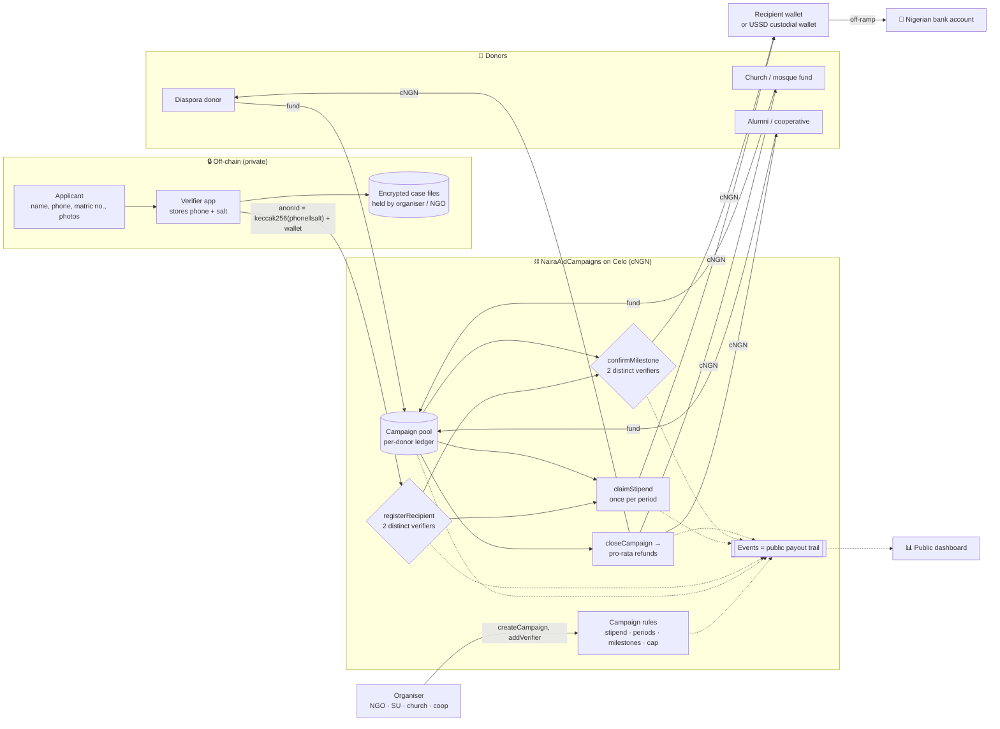

# 🇳🇬 NairaAid

**Transparent, rules-based aid and community payouts in naira stablecoin (cNGN) on Celo.**

Donors fund a campaign → trusted local verifiers confirm who qualifies → recipients are paid in naira by rules nobody can bend → every kobo is publicly traceable, and whatever isn't spent goes back to donors.

> SMU Web3 for Social Good Hackathon 2026 (DoraHacks)
> Built by **Lawal Ridwan**, frontend & web3 developer, Nigeria · MIT licence
> Live demo: https://remmylof.github.io/nairaaid/
>
> ⚠️ **Unaudited hackathon prototype. Testnets only (Celo Sepolia / Base Sepolia / local Hardhat).**

---

## 1. The problem

When floods, fires or school-fee crises hit Nigerian communities, help comes from NGOs, churches and mosques, student unions, cooperatives (*ajo/esusu*) and the diaspora. The money is real, but trust is low:

| Pain | What happens today |
| --- | --- |
| **"Where did the money go?"** | Donors get a WhatsApp screenshot or a PDF months later. Diaspora donors especially have no way to check. |
| **Leakage and ghost beneficiaries** | One coordinator controls the account and the list. Padded lists, "admin costs" and diversion are hard to detect. |
| **Slow, expensive payouts** | Cash handouts mean queues and middlemen. Cross-border donations lose a lot to FX and fees before reaching anyone. |
| **Unspent funds disappear** | When a relief drive ends, leftovers usually stay with the organiser. |
| **Privacy vs. transparency** | Publishing beneficiary lists exposes vulnerable people. Keeping them secret makes fraud easy. |

## 2. The solution

`NairaAidCampaigns` is a single smart contract that holds campaign funds in **cNGN** (the SEC-regulated, 1:1 naira-backed stablecoin) and only releases them by rules fixed when the campaign is created.

| Feature | How it works on-chain |
| --- | --- |
| **Campaign rules are fixed** | `createCampaign` sets the stipend per period, number of periods, milestone amounts (e.g. "School fees ₦50,000"), the recipient cap, and an eligibility document (`metadataURI`, IPFS). None of these can be changed later. |
| **Per-donor accounting** | `fund()` records every donation by address. The optional platform fee (capped at 3%) is paid by the donor **on top**, so recipients always receive the full rule amount. |
| **2-of-N verifier registration** | A recipient becomes active only when **two different verifiers** (a lecturer, SU welfare officer, imam/pastor, NGO field agent) attest the **same anonymous ID and the same payout wallet**. The organiser can never be a verifier. |
| **Anonymous recipients** | On-chain a recipient is only `anonId = keccak256(phone ‖ salt)` plus a wallet. No names, phone numbers or documents. |
| **Monthly stipends** | `claimStipend` pays every period that has started and not yet been claimed. Each period can be paid **exactly once**. Anyone (e.g. a USSD relayer paying gas) can trigger it, but the money only goes to the recipient's registered wallet. |
| **Milestone payouts** | `confirmMilestone` pays out automatically when a **second, different verifier** confirms (e.g. school-fee invoice seen). One verifier can't confirm twice. |
| **No organiser withdrawal** | There is no `withdraw`/`sweep` function at all. Tokens can only go to active recipients (by the rules) or back to donors. The organiser, fee recipient and verifiers can't be registered as recipient wallets. |
| **Pause / close** | The organiser can pause (freezes funding, registration and payouts) and close early. Anyone can close once the schedule has ended, so funds can't be held hostage. |
| **Pro-rata refunds** | On close, the unspent balance is snapshotted. Each donor reclaims `donation × unspent / totalRaised`. |
| **Public payout trail** | Every step emits an event (`Donated`, `RecipientAttested`, `RecipientRegistered`, `StipendClaimed`, `MilestoneConfirmed`, `Payout`, `CampaignClosed`, `Refunded`, …). `getDashboard()` returns raised / paid / refunded / balance / remaining / recipient, donor and verifier counts in one call. |

### Architecture



## 3. Why Web3 (and not just a spreadsheet or bank account)

- **Rules the organiser can't override.** A bank account belongs to whoever holds the token or signatory. Here the code itself has no path for the organiser to take the money, and donors can read that code.
- **Verifiable by anyone, in real time.** A diaspora donor in London can see the same payout trail as the committee in Ilorin, without asking for receipts.
- **Separation of duties enforced by code.** Registration and milestone payouts need two independent people; one compromised coordinator isn't enough.
- **Guaranteed refunds.** Leftover funds go back to donors pro-rata, automatically, not at the organiser's discretion.
- **Naira, not volatile crypto.** cNGN is a regulated, 1:1 naira-backed stablecoin, live on Celo since 6 Aug 2026 ([Celo blog](https://blog.celo.org/cngn-deploys-on-celo-bringing-the-nigerian-naira-to-the-leading-stablecoin-networks-onchain-fx-f2b570a079da)). Recipients think and spend in naira; Celo transfers cost a fraction of a cent, which matters when a stipend is ₦20,000.
- **Cheap cross-border giving.** Diaspora donors can fund in stablecoins and swap to cNGN on-chain (Textile FX and a cNGN/USDT Uniswap pool exist on Celo) instead of paying remittance fees.

## 4. Privacy model

| Data | Where it lives |
| --- | --- |
| Name, phone, matric/NIN, address, flood-damage photos, bank details | **Off-chain only.** Held by the verifier app / organiser, encrypted, under NDPA 2023 data-protection duties. |
| `anonId = keccak256(phone ‖ salt)` | On-chain. A fresh 32-byte random salt per recipient per campaign stops phone-number brute-forcing (Nigeria's phone space is small, so an unsalted hash would be reversible) and stops linking the same person across campaigns. |
| Payout wallet | On-chain. Can be a fresh wallet per campaign, or a custodial wallet held by an off-ramp/USSD partner. |
| Amounts, timestamps, which verifiers attested | On-chain, public. This is the point. |

- `computeAnonId()` exists for verifier apps to check their hashing **via `eth_call` only**. Sending a phone number in a transaction would publish it.
- To prove "I am recipient X" (for appeals), the recipient or verifier reveals phone + salt privately to an auditor, who recomputes the hash.
- Roadmap: replace salted hashes with zero-knowledge membership proofs (e.g. Semaphore) or Self Protocol attestations, so even the wallet ↔ anonId link can be hidden.

## 5. On/off-ramp plan

1. **Donors in:** Nigerian donors pay naira by bank transfer to a virtual account via the cNGN API (which supports collecting naira into virtual bank accounts and minting cNGN — [docs.cngn.co](http://docs.cngn.co/)), or buy cNGN on an exchange. Diaspora donors swap USDT/USDC → cNGN on Celo.
2. **Recipients out:** students with smartphones use a Celo wallet (MiniPay / Valora-style) and cash out through cNGN redemption or local P2P/exchange partners. The cNGN API supports converting cNGN to naira settled to a Nigerian bank account.
3. **Feature phones:** a USSD/WhatsApp partner holds a custodial wallet per recipient, triggers `claimStipend` as a relayer (paying gas), and pays out to the recipient's bank account or mobile money. The contract guarantees funds can only land in the registered wallet.
4. **Gas:** Celo supports paying gas in stablecoins, and Celo Core Co. has started governance to make cNGN a gas currency, so recipients won't need CELO.

> Note: this repo uses `MockCNGN` (6 decimals) for tests and the demo. Before pointing at real cNGN, check the deployed token's `decimals()` and address from the official cNGN docs. Don't confuse it with Mento's older naira token at `0xE270…6F71` on Celo, now listed as NGNm.

## 6. Roadmap

| Phase | Scope |
| --- | --- |
| **Now (hackathon)** | Contracts, 32 tests, end-to-end demo, deploy scripts for Celo Sepolia & Base Sepolia. |
| **Next 1–2 months** | Next.js dashboard reading `getDashboard` + events; verifier mobile web app (hash phone+salt locally, attest with one tap); Celo Sepolia deployment. |
| **Pilot (one semester)** | **20–50 students at a Nigerian university** (e.g. flood- or fee-affected students at UNILORIN), run with the student union welfare office and 3–5 staff/faith-leader verifiers. Measure: time from donation to payout, cost per payout, donor satisfaction, % of funds traceable. |
| **Scale** | NGO partners (relief, scholarship, widows' and orphans' funds), USSD/WhatsApp bot for claims and balance checks, cooperative (*ajo/esusu*) mode with rotating payouts, multi-sig/DAO organiser option, Self/zk identity, independent audit before any mainnet use. |

## 7. Sustainability & revenue

- **Optional platform fee (0–3%)**, paid by donors on top of their gift, never deducted from recipients. Shown up-front in the campaign.
- **NGO / institution plans:** hosted dashboard, verifier onboarding, reporting exports for donors and auditors, white-label campaign pages.
- **Off-ramp partner revenue share** on naira conversions handled through partners.
- **Grants** from ecosystem and social-impact funds (Celo, public-goods funding) for the open-source core.
- Costs stay low: one contract serves many campaigns, and Celo gas per payout is a fraction of a cent.

## 8. Risks & mitigations

| Risk | Mitigation (current / planned) |
| --- | --- |
| **Two verifiers collude** (or the organiser adds two puppets) | 2-of-N is a floor, not a guarantee. Verifier set is public with `VerifierAdded` events; donors can see it before giving. Recipient cap and fixed amounts bound the worst case. Planned: 3-of-N option, verifier staking/reputation, verifier lock-in after first donation. |
| **Smart-contract bugs** | OpenZeppelin 5 (`SafeERC20`, `ReentrancyGuard`), custom errors, checks-effects-interactions, 32 tests incl. a hostile-token reentrancy test. **Not audited**; testnets only until audited. |
| **Underfunding** | Payouts revert with `InsufficientFunds` rather than over-paying from another campaign; each campaign's balance is accounted separately. |
| **Stablecoin/issuer risk** | cNGN is regulated and reserve-backed, but issuer freeze/depeg risk exists. Token is per-campaign, so another stablecoin can be used. |
| **Regulation & data protection** | Personal data off-chain (NDPA 2023); KYC/AML handled by licensed on/off-ramp partners; organiser KYC summary linked in `metadataURI`. |
| **Lost keys / feature phones** | Custodial USSD wallets via partners; pending registrations can be re-done under a new anonId. Planned: verifier-approved wallet rotation. |
| **Rounding dust** | Pro-rata refunds round down; less than ₦0.000001 (one base unit) per donor can remain in the contract. |
| **Wallet reservation by a lone verifier** | A single attestation reserves the wallet until a second verifier agrees; it pays nothing. Planned: expiry for stale attestations. |

## 9. Contracts

| File | Purpose |
| --- | --- |
| `contracts/NairaAidCampaigns.sol` | Multi-campaign aid contract (campaigns, donations, verifiers, recipients, stipends, milestones, pause/close, refunds, dashboard views). |
| `contracts/MockCNGN.sol` | Test cNGN: ERC-20, 6 decimals, owner-only `mint`. **Testnets only.** |
| `contracts/test/ReentrantToken.sol` | Test-only hostile token used to prove reentrancy protection. |

Key functions: `createCampaign`, `addVerifier`, `removeVerifier`, `fund`, `registerRecipient`, `claimStipend`, `confirmMilestone`, `pause`, `unpause`, `closeCampaign`, `claimRefund`, and views `getCampaign`, `getDashboard`, `balanceOf`, `totalPaid`, `remaining`, `recipientCount`, `getRecipient`, `getMilestones`, `milestoneStatus`, `claimableStipend`, `refundableAmount`, `endTime`, `periodsElapsed`, `computeAnonId`.

## 10. Setup, test, demo

Requirements: Node.js 18+ (tested on v22.23.3), npm.

```bash
npm install
npx hardhat compile
npx hardhat test          # 32 passing
npm run demo              # Ilorin flood-relief walkthrough (local Hardhat network)
```

The demo funds a ₦500,000 campaign from three donors, registers 5 students with 2 verifiers each, pays a monthly stipend, pays school fees after two verifier confirmations, blocks a single-verifier collusion attempt (and several other attacks), closes the campaign and refunds the ₦100,000 left over pro-rata. A sample run is saved in [`demo-output.txt`](./demo-output.txt).

### Deploy to a testnet

```bash
cp .env.example .env      # add DEPLOYER_PRIVATE_KEY (a throwaway testnet key), never commit .env
npm run deploy:celoSepolia   # Celo Sepolia, chainId 11142220 (Alfajores was retired)
npm run deploy:baseSepolia   # Base Sepolia, chainId 84532
npm run deploy:local         # in-process Hardhat network
```

If `CNGN_ADDRESS` is empty the script deploys `MockCNGN` and mints test tokens to the deployer. Get testnet gas from the Celo Sepolia / Base Sepolia faucets.

## 11. Licence

MIT © 2026 Lawal Ridwan. See [LICENSE](./LICENSE).
